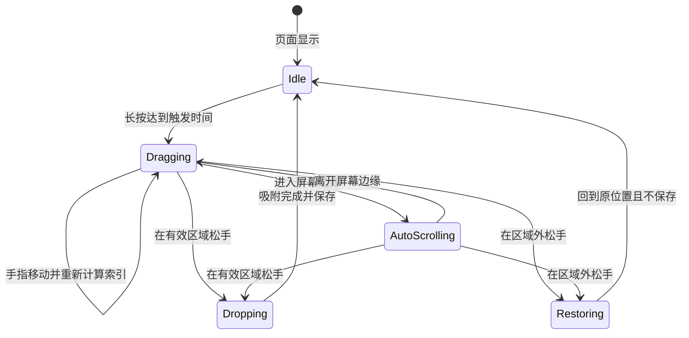
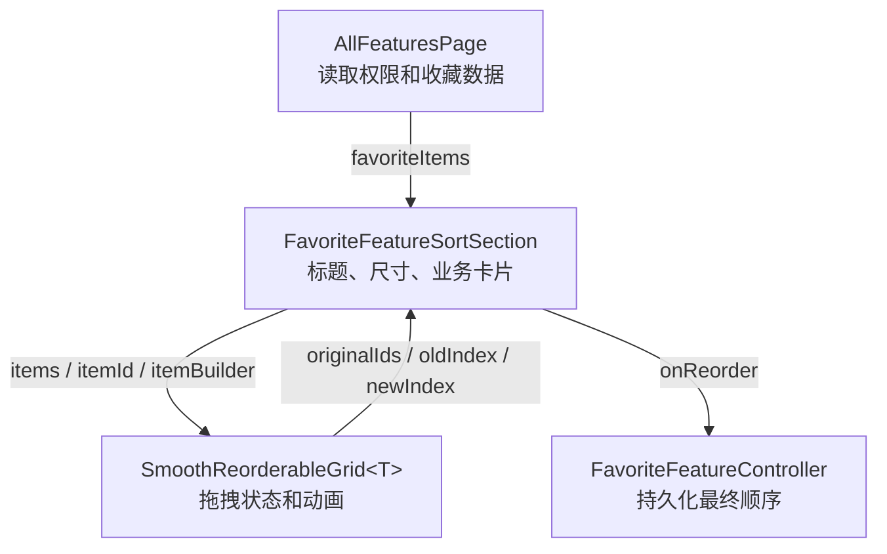

# 从零实现 Flutter 丝滑拖拽排序网格

> 本文通过一个三列功能方块网格，逐步实现类似手机桌面图标的拖拽体验：长按拖起、横向和纵向换位、平滑补位、边缘自动滚动、松手吸附，以及拖出区域后恢复原顺序。

## 目录

- [1. 最终要实现什么](#1-最终要实现什么)
- [2. 开始前需要理解的三个概念](#2-开始前需要理解的三个概念)
- [3. 第零步：准备最小数据模型](#3-第零步准备最小数据模型)
- [4. 第一步：用 Stack 建立可控制位置的三列网格](#4-第一步用-stack-建立可控制位置的三列网格)
- [5. 第二步：加入长按拖动](#5-第二步加入长按拖动)
- [6. 第三步：把手指坐标转换成目标索引](#6-第三步把手指坐标转换成目标索引)
- [7. 第四步：移动数据并让其他方块平滑补位](#7-第四步移动数据并让其他方块平滑补位)
- [8. 第五步：增加换位防抖](#8-第五步增加换位防抖)
- [9. 第六步：实现屏幕边缘自动滚动](#9-第六步实现屏幕边缘自动滚动)
- [10. 第七步：拖出区域时取消并恢复](#10-第七步拖出区域时取消并恢复)
- [11. 第八步：实现松手吸附动画](#11-第八步实现松手吸附动画)
- [12. 第九步：抽成通用 Widget](#12-第九步抽成通用-widget)
- [13. 如何接入收藏功能业务](#13-如何接入收藏功能业务)
- [14. 如何编写拖拽 Widget 测试](#14-如何编写拖拽-widget-测试)
- [15. 参数调优指南](#15-参数调优指南)
- [16. 常见问题和错误方案](#16-常见问题和错误方案)
- [17. 推荐学习顺序](#17-推荐学习顺序)
- [18. 当前项目代码对照](#18-当前项目代码对照)

---

## 1. 最终要实现什么

假设页面中有一组功能入口：

```text
A  B  C
D  E  F
G  H  I
```

用户长按 `A`，然后把它拖到 `E` 的位置，最终顺序变为：

```text
B  C  D
E  A  F
G  H  I
```

这个看似简单的过程，实际上包含多个独立问题：

1. 如何知道当前拖动的是哪个数据？
2. 如何把手指的屏幕坐标换算成第几个格子？
3. 如何移动数据，而不是只移动画面？
4. 如何让其他卡片平滑补位，而不是突然跳动？
5. 手指停在屏幕边缘时，页面如何自动滚动？
6. 松手后，悬浮卡片如何吸附回最终格子？
7. 拖出有效区域后，如何恢复原始顺序？
8. 如何把这些逻辑封装成其他页面也能使用的 Widget？

本文按照这个顺序逐个解决。

### 完整交互状态



---

## 2. 开始前需要理解的三个概念

### 2.1 Widget 位置和数据顺序是两件事

拖动排序不能只改变卡片的 `Offset`。真正决定业务顺序的是列表：

```dart
final items = ['A', 'B', 'C'];
```

把 `A` 移动到索引 `1`，应该修改为：

```dart
final movedItem = items.removeAt(0);
items.insert(1, movedItem);
```

界面位置只是数据顺序的视觉结果。

### 2.2 Flutter 中存在不同坐标系

拖拽回调给出的通常是全局坐标：

```dart
details.globalPosition
```

但计算网格行列时，需要的是相对于网格左上角的局部坐标：

```dart
final localPosition = gridRenderBox.globalToLocal(
  details.globalPosition,
);
```

如果直接用全局坐标计算行列，页面滚动、状态栏、安全区域都会让结果偏移。

### 2.3 动画需要稳定的身份标识

每个方块必须有稳定且唯一的 Key：

```dart
key: ValueKey(item.id)
```

不能使用当前索引：

```dart
// 错误示例：排序后 index 会变化，Flutter 会认错卡片。
key: ValueKey(index)
```

`ValueKey(item.id)` 告诉 Flutter：“虽然这个卡片的位置变了，但它仍然是同一个卡片。”

---

## 3. 第零步：准备最小数据模型

先不要接入真实接口，使用最简单的数据模型：

```dart
class DemoItem {
  const DemoItem({required this.id, required this.title});

  final String id;
  final String title;
}
```

准备九个功能：

```dart
final demoItems = List.generate(
  9,
  (index) => DemoItem(
    id: 'feature-$index',
    title: '功能 ${index + 1}',
  ),
);
```

页面最初只需要一个可变列表：

```dart
class ReorderDemoPage extends StatefulWidget {
  const ReorderDemoPage({super.key});

  @override
  State<ReorderDemoPage> createState() => _ReorderDemoPageState();
}

class _ReorderDemoPageState extends State<ReorderDemoPage> {
  late List<DemoItem> _items;

  @override
  void initState() {
    super.initState();
    _items = List.of(demoItems);
  }

  @override
  Widget build(BuildContext context) {
    return const Placeholder();
  }
}
```

为什么要使用 `List.of`？因为调用方传进来的列表可能是不可修改列表，也可能仍被其他模块持有。复制一份可以避免直接修改外部状态。

---

## 4. 第一步：用 Stack 建立可控制位置的三列网格

### 4.1 为什么不直接使用 GridView

`GridView` 非常适合普通网格，但它主要负责“根据索引摆放子组件”。当顺序改变时，子组件通常直接出现在新索引位置。

我们希望控制的是：

```text
旧坐标 ──动画插值──> 新坐标
```

因此使用下面的组合：

```text
SizedBox：确定整个网格尺寸
└── Stack：允许每个卡片独立定位
    └── AnimatedPositioned：位置变化时自动播放动画
```

### 4.2 计算每个方块的宽度

假设：

```dart
const crossAxisCount = 3;
const spacing = 10.0;
```

可用宽度为 `availableWidth`，则每个卡片宽度为：

```dart
final tileWidth =
    (availableWidth - spacing * (crossAxisCount - 1)) /
    crossAxisCount;
```

三列之间只有两个间距，所以要减去：

```text
spacing × (列数 - 1)
```

### 4.3 从索引计算行列

```dart
final column = index % crossAxisCount;
final row = index ~/ crossAxisCount;
```

例如三列网格：

| index | row | column |
| ---: | ---: | ---: |
| 0 | 0 | 0 |
| 1 | 0 | 1 |
| 2 | 0 | 2 |
| 3 | 1 | 0 |
| 4 | 1 | 1 |

计算左上角坐标：

```dart
final left = column * (tileWidth + spacing);
final top = row * (mainAxisExtent + spacing);
```

### 4.4 建立最小网格

```dart
LayoutBuilder(
  builder: (context, constraints) {
    const columns = 3;
    const spacing = 10.0;
    const itemHeight = 94.0;

    final tileWidth =
        (constraints.maxWidth - spacing * (columns - 1)) /
        columns;
    final rowCount = (_items.length + columns - 1) ~/ columns;
    final gridHeight =
        rowCount * itemHeight + (rowCount - 1) * spacing;

    return SizedBox(
      width: constraints.maxWidth,
      height: gridHeight,
      child: Stack(
        children: List.generate(_items.length, (index) {
          final item = _items[index];
          final column = index % columns;
          final row = index ~/ columns;

          return AnimatedPositioned(
            key: ValueKey(item.id),
            duration: const Duration(milliseconds: 190),
            curve: Curves.easeOutCubic,
            left: column * (tileWidth + spacing),
            top: row * (itemHeight + spacing),
            width: tileWidth,
            height: itemHeight,
            child: _DemoCard(item: item),
          );
        }),
      ),
    );
  },
)
```

卡片可以先写得很简单：

```dart
class _DemoCard extends StatelessWidget {
  const _DemoCard({required this.item});

  final DemoItem item;

  @override
  Widget build(BuildContext context) {
    return DecoratedBox(
      decoration: BoxDecoration(
        color: Colors.white,
        borderRadius: BorderRadius.circular(8),
        border: Border.all(color: const Color(0xFF8FE4E8)),
      ),
      child: Center(child: Text(item.title)),
    );
  }
}
```

到这里还不能拖动，但已经完成最关键的布局基础。

---

## 5. 第二步：加入长按拖动

Flutter 提供了 `LongPressDraggable`：

```dart
LongPressDraggable<String>(
  data: item.id,
  delay: const Duration(milliseconds: 220),
  hapticFeedbackOnStart: true,
  feedback: feedbackCard,
  childWhenDragging: placeholderCard,
  child: normalCard,
)
```

三个重要的视觉部分：

| 属性 | 作用 |
| --- | --- |
| `child` | 没有拖动时显示的正常卡片 |
| `feedback` | 跟随手指移动的悬浮卡片 |
| `childWhenDragging` | 原位置留下的占位卡片 |

### 5.1 记录当前拖动项

新增状态：

```dart
String? _draggedId;
```

开始拖动时记录 ID：

```dart
onDragStarted: () {
  setState(() => _draggedId = item.id);
},
```

### 5.2 制作悬浮效果

```dart
feedback: Material(
  color: Colors.transparent,
  elevation: 16,
  shadowColor: Colors.black.withValues(alpha: 0.24),
  borderRadius: BorderRadius.circular(8),
  child: SizedBox(
    width: tileWidth,
    height: itemHeight,
    child: Transform.scale(
      scale: 1.06,
      child: card,
    ),
  ),
),
```

原位置保留弱化占位：

```dart
childWhenDragging: Opacity(
  opacity: 0.16,
  child: Transform.scale(
    scale: 0.96,
    child: card,
  ),
),
```

这一阶段可以拖起卡片，但其他卡片还不会换位。

---

## 6. 第三步：把手指坐标转换成目标索引

### 6.1 给网格设置 GlobalKey

```dart
final GlobalKey _gridKey = GlobalKey();
```

设置给最外层网格：

```dart
SizedBox(
  key: _gridKey,
  child: Stack(...),
)
```

### 6.2 全局坐标转局部坐标

```dart
final gridContext = _gridKey.currentContext;
if (gridContext == null) return;

final renderObject = gridContext.findRenderObject();
if (renderObject is! RenderBox || !renderObject.hasSize) return;

final localPosition = renderObject.globalToLocal(
  details.globalPosition,
);
```

### 6.3 以格子中心线为换位边界

最直接的方法是：

```dart
column = localPosition.dx ~/ horizontalStride;
```

但这种算法只要手指刚进入下一个格子的边缘，就会立即换位，边界附近容易来回抖动。

更自然的方法是使用相邻格子的中心线：

```dart
int nearestIndexForPosition({
  required Offset localPosition,
  required double availableWidth,
  required int itemCount,
  required int crossAxisCount,
  required double spacing,
  required double mainAxisExtent,
}) {
  if (itemCount <= 0) return -1;

  final tileWidth =
      (availableWidth - spacing * (crossAxisCount - 1)) /
      crossAxisCount;
  final horizontalStride = tileWidth + spacing;
  final verticalStride = mainAxisExtent + spacing;

  final column =
      ((localPosition.dx - tileWidth / 2) / horizontalStride)
          .round()
          .clamp(0, crossAxisCount - 1);

  final maxRow = (itemCount - 1) ~/ crossAxisCount;
  final row =
      ((localPosition.dy - mainAxisExtent / 2) / verticalStride)
          .round()
          .clamp(0, maxRow);

  return (row * crossAxisCount + column).clamp(0, itemCount - 1);
}
```

最后的 `clamp` 非常重要。最后一行可能只有一个卡片，如果手指移动到第二、第三个空白格，不应该产生超过列表范围的索引。

### 6.4 在拖动更新中调用

```dart
onDragUpdate: (details) {
  final targetIndex = nearestIndexForPosition(
    localPosition: localPosition,
    availableWidth: constraints.maxWidth,
    itemCount: _items.length,
    crossAxisCount: columns,
    spacing: spacing,
    mainAxisExtent: itemHeight,
  );
},
```

---

## 7. 第四步：移动数据并让其他方块平滑补位

先找到当前拖动项所在索引：

```dart
final oldIndex = _items.indexWhere(
  (item) => item.id == _draggedId,
);
```

如果目标索引有效且不同，移动列表数据：

```dart
if (oldIndex < 0 || targetIndex < 0 || oldIndex == targetIndex) {
  return;
}

setState(() {
  final movedItem = _items.removeAt(oldIndex);
  _items.insert(targetIndex, movedItem);
});
```

这里不需要手动启动补位动画。因为每个卡片都使用：

```dart
AnimatedPositioned(
  key: ValueKey(item.id),
  duration: const Duration(milliseconds: 190),
  curve: Curves.easeOutCubic,
  ...
)
```

列表顺序改变后：

1. 同一个 `item.id` 仍被 Flutter 识别为同一个 Widget。
2. 它的 `left` 和 `top` 发生变化。
3. `AnimatedPositioned` 自动从旧坐标过渡到新坐标。

这就是平滑补位的核心。

---

## 8. 第五步：增加换位防抖

即使使用中心线，手指在边界附近细微晃动时仍可能快速重复触发。

记录上一次成功换位时的网格局部坐标：

```dart
Offset? _lastReorderLocalPosition;
```

设置最小移动距离：

```dart
static const _reorderHysteresis = 12.0;
```

换位前判断：

```dart
final lastPosition = _lastReorderLocalPosition;
if (lastPosition != null &&
    (localPosition - lastPosition).distance < _reorderHysteresis) {
  return;
}
```

换位成功后更新：

```dart
setState(() {
  final movedItem = _items.removeAt(oldIndex);
  _items.insert(targetIndex, movedItem);
  _lastReorderLocalPosition = localPosition;
});
```

注意这里记录的是局部坐标，而不是全局坐标。页面自动滚动时，手指全局坐标可能不变，但手指相对于网格的位置会变化。

---

## 9. 第六步：实现屏幕边缘自动滚动

### 9.1 为什么使用 Ticker

边缘滚动需要跟随屏幕刷新频率持续更新位置：

```text
每一帧：当前位置 + 速度 × 本帧时间
```

`Timer.periodic` 不与屏幕刷新同步，容易出现不均匀滚动。Flutter 动画系统的 `Ticker` 更适合这个场景。

State 需要混入：

```dart
class _GridState extends State<Grid>
    with TickerProviderStateMixin {
```

创建和释放 Ticker：

```dart
late final Ticker _autoScrollTicker;

@override
void initState() {
  super.initState();
  _autoScrollTicker = createTicker(_handleAutoScrollTick);
}

@override
void dispose() {
  _autoScrollTicker.dispose();
  super.dispose();
}
```

### 9.2 根据手指位置计算速度

```dart
static const _edgeExtent = 72.0;
static const _minVelocity = 120.0;
static const _maxVelocity = 720.0;
```

靠近底部时：

```dart
final bottomBoundary =
    screenHeight - safeBottom - _edgeExtent;

if (globalPosition.dy > bottomBoundary) {
  final intensity =
      ((globalPosition.dy - bottomBoundary) / _edgeExtent)
          .clamp(0.0, 1.0);

  velocity =
      _minVelocity +
      (_maxVelocity - _minVelocity) * intensity;
}
```

`intensity` 从 `0` 到 `1`：

- 刚进入边缘区域：慢速滚动。
- 越接近屏幕边缘：速度越快。
- 到最边缘：达到最大速度。

顶部同理，但速度为负数。

### 9.3 每帧滚动外层页面

```dart
Duration? _lastAutoScrollElapsed;
double _autoScrollVelocity = 0;

void _handleAutoScrollTick(Duration elapsed) {
  final previous = _lastAutoScrollElapsed;
  _lastAutoScrollElapsed = elapsed;
  if (previous == null) return;

  final scrollable = Scrollable.maybeOf(context);
  if (scrollable == null) return;

  final seconds =
      ((elapsed - previous).inMicroseconds /
              Duration.microsecondsPerSecond)
          .clamp(0.0, 0.05);

  final position = scrollable.position;
  final target =
      (position.pixels + _autoScrollVelocity * seconds)
          .clamp(position.minScrollExtent, position.maxScrollExtent)
          .toDouble();

  position.jumpTo(target);
}
```

为什么每帧使用 `jumpTo`，而不是反复调用 `animateTo`？

`Ticker` 已经负责逐帧平滑更新，如果每一帧再启动一个新的 `animateTo`，会产生大量互相覆盖的动画。

### 9.4 自动滚动后重新计算换位

这是最容易漏掉的一步：页面在滚动，但手指可能没有产生新的 `onDragUpdate`。

因此每次滚动后都要使用最新手指位置重新计算：

```dart
position.jumpTo(target);

if (_latestDragGlobalPosition != null) {
  _updateReorderForGlobalPosition(
    _latestDragGlobalPosition!,
    availableWidth,
  );
}
```

---

## 10. 第七步：拖出区域时取消并恢复

### 10.1 拖动开始时保存快照

```dart
List<String> _originalIds = const [];

void _startDrag(String id) {
  _originalIds = _items
      .map((item) => item.id)
      .toList(growable: false);
}
```

只保存 ID，而不是复制所有业务对象，能够明确表达“我们保存的是顺序快照”。

### 10.2 判断松手位置是否有效

```dart
bool _isDropInsideGrid(Offset globalPosition) {
  final renderObject =
      _gridKey.currentContext?.findRenderObject();
  if (renderObject is! RenderBox || !renderObject.hasSize) {
    return false;
  }

  final localPosition = renderObject.globalToLocal(globalPosition);
  final bounds = (Offset.zero & renderObject.size).inflate(36);
  return bounds.contains(localPosition);
}
```

这里使用 `inflate(36)` 给网格外围增加 36dp 容错区。用户稍微越过边缘时仍然视为有效操作。

### 10.3 按原始 ID 恢复顺序

```dart
List<DemoItem> restoreOriginalOrder() {
  final itemsById = {
    for (final item in _items) item.id: item,
  };

  return [
    for (final id in _originalIds) ?itemsById[id],
  ];
}
```

松手时：

```dart
final shouldRestore = !_isDropInsideGrid(pointerPosition);

if (shouldRestore) {
  setState(() {
    _items = restoreOriginalOrder();
  });
}
```

恢复过程中 `AnimatedPositioned` 仍会播放，所以不是突然跳回，而是平滑回到原排序。

---

## 11. 第八步：实现松手吸附动画

### 11.1 为什么需要 Overlay

`LongPressDraggable` 自带的 `feedback` 会在拖动结束后消失。如果真实卡片立即出现，会形成“悬浮卡片瞬间消失、目标卡片突然显示”的断层。

解决方案是在松手时创建一个短暂的 `OverlayEntry`：

```text
Draggable feedback 消失
          ↓
Overlay 中的复制卡片从松手位置飞向目标格子
          ↓
Overlay 消失，真实卡片显示
```

### 11.2 计算目标格子的全局坐标

```dart
Offset? targetGlobalOffset(int index) {
  final renderObject =
      _gridKey.currentContext?.findRenderObject();
  if (renderObject is! RenderBox) return null;

  final column = index % columns;
  final row = index ~/ columns;

  return renderObject.localToGlobal(
    Offset(
      column * (tileWidth + spacing),
      row * (itemHeight + spacing),
    ),
  );
}
```

### 11.3 创建吸附动画

```dart
final controller = AnimationController(
  vsync: this,
  duration: const Duration(milliseconds: 180),
);

final animation = CurvedAnimation(
  parent: controller,
  curve: Curves.easeOutCubic,
);
```

每一帧计算位置：

```dart
final offset = Offset.lerp(
  beginOffset,
  endOffset,
  animation.value,
)!;
```

同时恢复缩放和阴影：

```dart
Transform.scale(
  scale: 1.06 - 0.06 * animation.value,
  child: Material(
    elevation: 16 * (1 - animation.value),
    child: card,
  ),
)
```

### 11.4 吸附期间隐藏真实卡片

新增状态：

```dart
String? _droppingId;
```

真实卡片根据状态隐藏：

```dart
AnimatedOpacity(
  opacity: item.id == _droppingId ? 0 : 1,
  duration: const Duration(milliseconds: 60),
  child: draggable,
)
```

Overlay 动画结束后：

```dart
setState(() => _droppingId = null);
```

这样整个过程只会看到一张卡片。

### 11.5 必须释放动画资源

```dart
@override
void dispose() {
  _dropOverlayEntry?.remove();
  _dropAnimationController?.dispose();
  super.dispose();
}
```

还要处理页面退出导致的动画取消：

```dart
try {
  await controller.forward().orCancel;
} on TickerCanceled {
  // 页面退出时安全结束。
}
```

---

## 12. 第九步：抽成通用 Widget

如果拖拽代码仍然直接认识 `FeatureItem` 或收藏 Controller，它就无法被其他业务复用。

通用组件只需要五类信息：

1. 当前数据列表。
2. 如何获取每项的唯一 ID。
3. 如何绘制卡片。
4. 网格列数、间距和高度。
5. 排序完成后如何通知调用方。

### 12.1 定义泛型 Widget

```dart
typedef SmoothReorderItemBuilder<T> =
    Widget Function(BuildContext context, T item);

typedef SmoothReorderCallback =
    Future<void> Function(
      List<String> originalIds,
      int oldIndex,
      int newIndex,
    );

class SmoothReorderableGrid<T extends Object>
    extends StatefulWidget {
  const SmoothReorderableGrid({
    super.key,
    required this.items,
    required this.itemId,
    required this.itemBuilder,
    required this.metrics,
    required this.onReorder,
    this.dragDelay = const Duration(milliseconds: 220),
    this.topAutoScrollInset = 93,
  });

  final List<T> items;
  final String Function(T item) itemId;
  final SmoothReorderItemBuilder<T> itemBuilder;
  final AdaptiveFeatureGridMetrics metrics;
  final SmoothReorderCallback onReorder;
  final Duration dragDelay;
  final double topAutoScrollInset;
}
```

### 12.2 为什么只开放少量参数

第一版不要把每个动画值都做成参数。十几个可配置参数会让调用方无法判断应该使用什么值。

建议先固定已经验证过的手感：

```dart
static const _positionAnimationDuration =
    Duration(milliseconds: 190);
static const _dropAnimationDuration =
    Duration(milliseconds: 180);
static const _reorderHysteresis = 12.0;
static const _dropBoundaryPadding = 36.0;
static const _edgeAutoScrollExtent = 72.0;
```

只有当第二个页面确实需要不同参数时，再考虑建立 `SmoothReorderBehavior` 配置对象。

### 12.3 通用组件不应该做什么

不要在通用组件中：

- 调用收藏 Controller。
- 判断功能权限。
- 写死 `FeatureItem`。
- 决定卡片图标和颜色。
- 直接操作接口或数据库。
- 显示特定业务标题。

通用 Widget 只管理拖拽过程。

---

## 13. 如何接入收藏功能业务

收藏区域负责把业务模型翻译成通用组件需要的参数：

```dart
SmoothReorderableGrid<FeatureItem>(
  items: items,
  itemId: (item) => item.id,
  metrics: metrics,
  onReorder: onReorder,
  itemBuilder: (context, item) => HomeFeatureCard(
    item: item,
    label: item.title,
    iconColor: const Color(0xFF16A3DE),
    onTap: () {},
    compact: true,
  ),
)
```

页面层只负责传入数据和保存函数：

```dart
FavoriteFeatureSortSection(
  items: favoriteItems,
  onReorder: favorites.reorderVisible,
)
```

最终职责关系是：



---

## 14. 如何编写拖拽 Widget 测试

拖拽不能只测试最终列表，还应该模拟真实手势。

### 14.1 测试有效换位

```dart
final start = tester.getCenter(find.text('A'));
final target = tester.getCenter(find.text('B'));

final gesture = await tester.startGesture(start);

// 等待超过 LongPressDraggable 的触发时间。
await tester.pump(const Duration(milliseconds: 120));

await gesture.moveTo(target);
await tester.pump(const Duration(milliseconds: 220));
await gesture.up();
await tester.pumpAndSettle();

expect(originalIds, const ['A', 'B', 'C']);
expect(oldIndex, 0);
expect(newIndex, 1);
```

### 14.2 测试越界恢复

先移动到其他格子，再移动到网格外：

```dart
await gesture.moveTo(target);
await tester.pump(const Duration(milliseconds: 220));
await gesture.moveTo(const Offset(10, 500));
await gesture.up();
await tester.pumpAndSettle();

expect(saveCount, 0);
```

至少应该覆盖：

- 有效横向换位。
- 有效纵向换位。
- 最后一行不满时的索引限制。
- 拖出区域恢复。
- 排序回调只在真实变化后调用。
- Widget 销毁时不存在未释放的 Ticker。

---

## 15. 参数调优指南

| 参数 | 当前值 | 影响 |
| --- | ---: | --- |
| 长按时间 | 220ms | 越短越灵敏，也越容易误触 |
| 补位动画 | 190ms | 越短越跟手，过短会显得生硬 |
| 吸附动画 | 180ms | 控制松手后飞回格子的速度 |
| 拖起缩放 | 1.06 | 表达卡片已经离开页面平面 |
| 占位缩放 | 0.96 | 保留原位置提示但弱化视觉 |
| 占位透明度 | 0.16 | 越低越接近手机桌面效果 |
| 换位防抖 | 12dp | 越大越稳定，但快速小范围移动会变迟钝 |
| 越界容错 | 36dp | 防止手指轻微离开网格就取消 |
| 边缘滚动区 | 72dp | 越大越早触发自动滚动 |
| 最小滚动速度 | 120dp/s | 刚进入边缘区域时的速度 |
| 最大滚动速度 | 720dp/s | 紧贴屏幕边缘时的速度 |

建议每次只调整一个参数，并在 60Hz Android、120Hz Android 和 iPhone 真机分别感受。

不要用模拟器是否卡顿直接判断动画性能。模拟器还受到电脑负载、图形加速和缩放模式影响。

---

## 16. 常见问题和错误方案

### 16.1 使用 index 作为 Key

错误：

```dart
ValueKey(index)
```

结果：排序后 Flutter 可能复用错误的元素，动画看起来像内容突然交换。

正确：

```dart
ValueKey(item.id)
```

### 16.2 只改变坐标，不改变列表

画面看似完成排序，但页面重建后会恢复，保存到后端的顺序也不会改变。

正确做法是先修改数据顺序，再让坐标由新索引计算出来。

### 16.3 使用全局坐标直接计算行列

页面滚动后目标索引会偏移。必须先使用 `globalToLocal`。

### 16.4 每个卡片放一个 DragTarget

这种方法能完成基础拖拽，但边界取决于卡片命中区域：

- 卡片间距区域没有目标。
- 快速跨过多个卡片时可能漏掉。
- 横纵混合拖动容易产生跳变。

统一使用网格坐标计算目标索引会更稳定。

### 16.5 在每一帧调用 animateTo

边缘滚动过程中会不断创建新的滚动动画，导致动画互相打断。使用 `Ticker + jumpTo` 按帧推进。

### 16.6 自动滚动后不重新计算目标索引

手指不动时不会触发新的拖动回调，但页面已经移动，卡片会停止换位。滚动每一帧后要重新使用最新手指坐标计算。

### 16.7 忘记释放 Overlay 或 AnimationController

可能出现：

- 页面退出后仍有悬浮卡片。
- `Ticker was active when disposed`。
- 测试执行完仍有定时动画。

所有 Ticker、Controller 和 OverlayEntry 都必须在 `dispose` 中清理。

### 16.8 排序过程中直接保存每一次换位

一次拖动可能跨过很多格子。如果每次换位都写本地存储或调用接口，会造成频繁 I/O。

正确做法：

```text
拖动中：只修改内存中的显示顺序
松手后：只保存一次最终顺序
```

---

## 17. 推荐学习顺序

不要一次性复制完整生产代码。建议按照下面的练习顺序亲手实现：

### 练习一：静态三列网格

- 使用 `Stack + Positioned`。
- 能根据索引正确计算行列。
- 修改列表顺序后卡片能够出现在新位置。

### 练习二：平滑补位

- 改成 `AnimatedPositioned`。
- 给每个卡片设置稳定的 `ValueKey(id)`。
- 用按钮移动第一项，观察补位动画。

### 练习三：长按拖动

- 加入 `LongPressDraggable`。
- 实现悬浮卡片和原位置占位。
- 暂时只打印 `globalPosition`。

### 练习四：统一坐标换位

- 使用 `GlobalKey` 获取网格 `RenderBox`。
- 把全局坐标转为局部坐标。
- 实现行列与目标索引计算。
- 跨列、跨行拖动并修改列表。

### 练习五：稳定手感

- 加入中心线换位。
- 加入 12dp 防抖。
- 验证最后一行不满的情况。

### 练习六：完整体验

- 加入边缘自动滚动。
- 加入越界恢复。
- 加入 Overlay 吸附动画。
- 最后才接入真实收藏 Controller。

每完成一个练习就运行一次测试和真机验证，这样出现问题时能明确知道是在哪一层引入的。

---

## 18. 当前项目代码对照

本文对应的生产代码已经拆分为三层：

| 层级 | 文件 | 主要职责 |
| --- | --- | --- |
| 页面编排 | [`all_features_page.dart`](../lib/features/all_features/all_features_page.dart) | 获取权限、收藏数据，接收最终排序 |
| 收藏业务组件 | [`favorite_feature_sort_section.dart`](../lib/features/all_features/widgets/favorite_feature_sort_section.dart) | 标题、三列尺寸、`HomeFeatureCard` |
| 通用拖拽组件 | [`smooth_reorderable_grid.dart`](../lib/shared/widgets/smooth_reorderable_grid.dart) | 拖拽状态、换位、滚动、吸附、恢复 |
| 网格尺寸和索引算法 | [`adaptive_feature_grid.dart`](../lib/shared/adaptive_feature_grid.dart) | 响应式列数、间距、高度、目标索引 |
| 拖拽测试 | [`smooth_reorderable_grid_test.dart`](../test/shared/smooth_reorderable_grid_test.dart) | 有效换位和越界恢复测试 |
| 响应式测试 | [`responsive_layout_test.dart`](../test/features/responsive_layout_test.dart) | 三列布局和中心线边界测试 |

阅读项目代码时建议按照这个顺序：

1. 先看 `FavoriteFeatureSortSection` 如何使用通用组件。
2. 再看 `SmoothReorderableGrid.build` 如何绘制网格。
3. 看 `_updateDragPosition` 和 `_updateReorderForGlobalPosition`。
4. 看 `_handleAutoScrollTick`。
5. 最后看 `_finishDrag` 和 `_animateDrop`。

## 总结

一个流畅拖拽网格的核心不是某个复杂 API，而是把问题拆成几个明确步骤：

```text
稳定 ID
  → 索引计算位置
  → 手指坐标计算目标索引
  → 修改列表顺序
  → AnimatedPositioned 平滑补位
  → Ticker 驱动边缘滚动
  → Overlay 完成松手吸附
  → 最后一次性保存结果
```

掌握这套思路后，不仅可以实现功能图标排序，也可以用于看板卡片、照片墙、快捷入口、自定义仪表盘等需要二维拖拽排序的场景。
