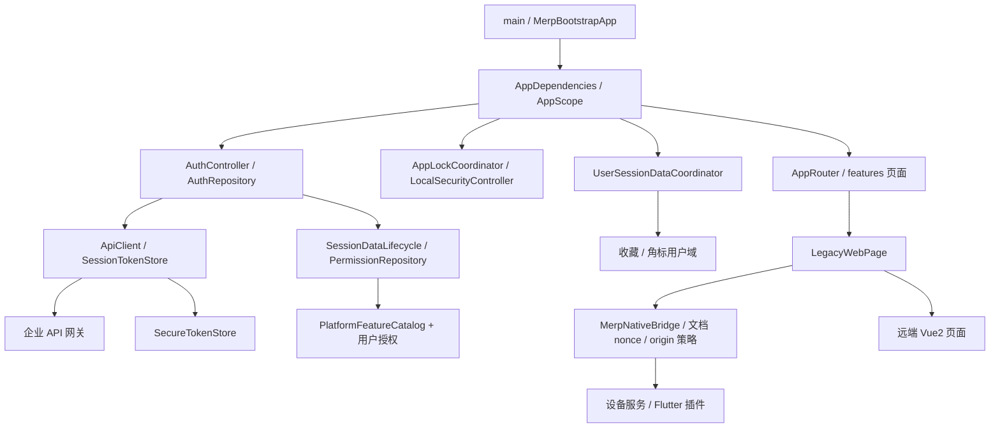

# MERP 项目知识基线

核验日期：2026-11-04。代码基线：`0b57a47`。本文依据当前源码、锁文件、项目文档及本会话可见的最终用户决策；未核验后端实现、其他电脑、本机私密配置和服务器部署。变动事项见 [HANDOFF](HANDOFF.md)。

## 1. 项目定位与范围

MERP 是原 Cordova 外壳的 Flutter 升级版，面向企业员工，覆盖销售、客服、行政、固资等移动业务。原 Vue2 页面继续通过 WebView 使用，Flutter 管理认证、平台功能目录、导航、系统安全、设备能力和本地体验。阶段是“真实接口接入 + 旧网页迁移 + 移动端体验与发布完善”，不是所有业务已原生化或已完成生产验收。

已实现代码范围：验证码登录、会话恢复/刷新、权限菜单、首页收藏排序/角标组件、更多功能拖拽、机器人 AI 入口、地图定位/扫码/文件/拍照 Bridge、三语言 UI、法律声明、手势/生物识别/自动锁屏、后台遮罩、服务器切换、版本升级与网页数据清理。

明确不做或尚未启动：桌面端产品；Windows 专用团队启动脚本；生产 Dart 代码热更新；Mock 发布包；自动发布服务器。固资离线 SQLite/CRUD Bridge 仍是待设计需求，不是现有能力。用户暂缓了更大的构建发布一致性重构，但已单独批准身份/签名隔离与必要修复。

## 2. 工具链与依赖

- `tool/versions`、`.fvmrc`：Flutter 3.44.6，FVM 4.1.2；`pubspec.yaml` Dart 约束 `^3.10.1`，Flutter 下限 3.44.5。不要把约束当实际已安装版本。
- 版本源：`pubspec.yaml` 当前 `1.0.0+10000`；业务/脚本约束 build number 为五位数字。
- Android：Gradle 8.14、AGP 8.11.1、Kotlin 2.2.20，Java 编译目标 17，最低 API 24；编译 SDK/NDK 随项目 Flutter 配置。
- iOS：CocoaPods，`enable-swift-package-manager: false`。百度相关 SDK 的模拟器架构兼容曾阻塞开发，不保证任意新模拟器都可用。
- 状态：ChangeNotifier + AppScope（InheritedWidget），路由 go_router。没有已采用的 Riverpod/GetIt/Bloc 全局迁移。

以下为 `pubspec.lock` 解析版本（不是升级建议）：

| 依赖 | 版本 | 职责 |
| --- | --- | --- |
| go_router / dio | 17.3.0 / 5.9.2 | 路由 / HTTP |
| webview_flutter | 4.13.1 | Vue2 容器 |
| flutter_secure_storage / shared_preferences | 10.3.1 / 2.5.5 | 凭证 / 非敏感偏好 |
| local_auth | 3.0.1 | 系统生物识别 |
| flutter_baidu_mapapi_base / map / flutter_bmflocation | 4.0.1+1 / 4.0.1 / 3.8.4 | 地图与定位 |
| image_picker / file_picker / mobile_scanner | 1.2.2 / 11.0.2 / 7.4.0 | 图片、文件、扫码 |
| permission_handler / device_info_plus / package_info_plus | 12.0.3 / 12.4.0 / 9.0.1 | 权限、设备、包版本 |
| crypto / flutter_native_splash | 3.0.7 / 2.4.8 | 哈希 / 构建期启动资源 |

## 3. 架构与边界

- `lib/main.dart` 安装全局异常捕获并尽快渲染；`MerpBootstrapApp` 承载初始化状态和失败重试。
- `lib/app/app_dependencies.dart` 明确创建与释放服务，不在页面随意创建长生命周期依赖。
- `lib/routing/app_router.dart` 处理 booting、restoreFailed、未登录、待安全设置等路由守卫。
- `core/auth` 通过 `SessionDataLifecycle` 接口调用权限生命周期；收藏/角标跨域协调留在 app 层。
- `core/security` 是本地凭证和能力；`app/security` 是锁屏、前后台与 UI 编排。SettingsController 的安全方法是兼容代理，不是新逻辑入口。
- `features/home/data/platform_feature_catalog.dart` 是本地完整功能目录；`mock_user_feature_permissions.dart` 只描述 Mock 用户授权，不复制标题、图标与路由。

## 4. 关键数据流与接口

### 登录与恢复

1. 登录页可点击提交，逐项提示账号、密码、验证码、协议勾选；校验通过后提交中禁用并显示加载状态。
2. `GET /api/v1/auth/captcha` 匿名获取 `imagebase64`、`captchaId`；模型处理 data URI 前缀。登录实际字段为 `captchaCode`，不是早期讨论的 `captcheCode`。
3. `POST /api/v1/auth/login`：`username/password/captchaId/captchaCode/appId/source/environment`；当前 appId=merp、source=1、认证 environment 默认 merp，不等同 qas/prd。
4. 令牌安全保存；账号密码登录进入 `authenticatedPendingSecurity`，经本地安全设置编排后放行；首次设置手势后进入首页。
5. 冷启动仅用 refresh token 调刷新接口恢复会话，不直接信任旧 access token；恢复成功可先进入首页后覆盖本地解锁（这是用户允许的行为）。资料和权限后台补载。
6. 恢复时网络/超时/服务异常与明确凭证无效区分处理；失败恢复页允许重试，不能一概删掉 refresh token。
7. 并发 401 使用单飞刷新；SessionTokenStore 以及控制器 generation 防止退出/换账号后旧异步结果回写。
8. 登出先撤销本地会话，尽力通知后端，清权限并等待网页数据清理。原生清理失败记录告警后仍允许退出（存在残留网页会话风险，见交接）。

`AppConfig` 定义路径：refresh `/api/v1/auth/refresh`、logout `/api/v1/auth/logout`、资料 `/api/v1/user/userInfo`。logout 请求字段当前为 `refreshToken`，handoff 为 `refresh_token`，不要因命名不同擅自统一。

### 权限、收藏与首页

- 带 Bearer Token 的 `POST /api/v1/app/features`：`appId=merp`、`lang=zh_CN/zh_TW/en_US`、`sys_app_features=at`，解析 `groups/items` 后映射到平台 ID。
- 全部功能展示本地平台所有入口；未授权置灰且不能收藏，点击提示“没有权限，无法使用”（三语言）。未知后端编码忽略并告警。
- 图标仍用本地 Material Icons 映射，不采用服务端 icon/iconUrl。权限响应可以覆盖显示标题与 legacyPath，但不能自行扩展 WebView 可信 origin。
- 首页仅显示授权收藏；拖拽组件为 `shared/widgets/smooth_reorderable_grid.dart`，支持二维重排/滚动，业务持久化不放入拖拽组件。
- `FeatureBadgeController` 统一首页/全部功能计数；正常后端角标接口尚未接入，只有替换方法和 Mock 计数。
- AI 入口使用 ai-search 功能、两帧本地图片轻动画，自由拖动并自动吸边。

### WebView 与 Bridge

- 打开/重试 Vue2 页前 `POST /api/v1/auth/handoff`，请求体 `refresh_token`，读取业务数据中的 `code`。旧 `/exchange` 路径已废弃。
- `WebCodeUrl.append` 将 `code` 放在 URL 的 `#` 路由之前的 query 中，编码且不缓存复用。一次性兑换/有效期由后端保证，具体 TTL 尚未核验，不能把曾讨论的 30 秒写成事实。
- `WebAccessPolicy` 按协议、host、port 精确可信 origin 校验；一次页面访问只允许同 origin 导航。后端菜单 URL 不自动成为可信源。
- 容器注册 `MerpNative` channel，并在页面完成时注入 `window.MERPBridge` 2.4.0；Vue 等待 `MERPBridgeReady`，通过 Promise `call(action,payload)` 调用。
- 文档 nonce、请求 ID、导航撤销和会话 generation 限制旧回调；不能防住所有同源 XSS，不宣称绝对原生 frame 来源鉴别。
- 当前 action 包含鉴权会话、登出、关闭页、资源清单、语言、Toast、拍照、文件、设备、定位、扫码、弹窗、系统设置。**没有 SQLite/executeSql action。**
- 兼容性例外：`auth.getSession` 仍向可信 H5 提供短期 access token（兼容 token 字段），首次页面请求也带 Authorization；refresh token 不暴露给 H5。handoff 并不意味着已经彻底移除 H5 Token。

### 版本更新

- 匿名 `POST /api/v1/app/version/check`：`platform/versionCode/locale`。
- 返回模型包括 `updateType/latestVersionName/latestVersionCode/minimumVersionCode/releaseNotes/downloadUrl`。
- 本地 code 小于 minimum：强制；否则小于 latest：可选；否则无更新。当前客户端自行计算并对服务端 type 差异告警。
- Android 下载进度及系统安装器；iOS 打开 HTTPS 或 itms-services 企业安装入口；Mock 只模拟下载。
- **启动自动检查调用在 AppDependencies 中已注释**；设置页手动检测仍在。不要依据注释文字误写为启动时已自动执行。

## 5. 数据存储与安全

| 数据 | 当前位置/边界 |
| --- | --- |
| Token 对 | SecureTokenStore，flutter_secure_storage，按 qas/prd/mock 环境命名空间；bundle v2 单次写入并兼容旧键 |
| 用户资料/权限 | 当前会话内存；头像读取 UserProfile.avatarUrl，先前拼接方案已要求回滚，不视作当前实现 |
| 收藏/排序 | SharedPreferences v3，环境 + 用户 ID；ID 未齐时用账号临时域，同一会话补资料后安全迁移；不认领旧无所有者 v2 数据 |
| 角标 | 内存，带 generation；退出清空 |
| 语言/服务器 | SharedPreferences；语言当前默认简体，China/HK 选择按环境保存 |
| 手势 | 安全存储中的盐+PBKDF2-HMAC-SHA256，120000 次，兼容 v2；计算隔离、写删串行 |
| 指纹/面容 | 操作系统识别，不存储生物特征；App 保存选择与用户安全域，能力/已录入状态由系统检测 |
| H5 数据 | 系统 WebView 缓存/Cookie/站点存储，与 App Token/偏好独立 |
| SQLite | 未引入依赖、无表结构/CRUD/迁移实现 |

收藏退出清内存但保留所属用户的持久数据；不同用户及环境隔离。China/HK 用户确认属于同数据域，切换不要求重新登录或拆分收藏。

本地解锁三选一（手势/面容/指纹），按设备能力启用；不能笼统宣称所有 iOS 都没有 Touch ID。自动锁屏阈值 10 秒，手势错误 5 次退出重登，不实施倒计时等待。纯色后台遮罩与身份锁屏独立；Android 13+ 原生禁最近任务截图，7–12 未启用 FLAG_SECURE，不保证完全无快照泄漏。

网页清理：Flutter WebDataCleaner 调 MethodChannel；Android 临时 WebView 清缓存、WebStorage.deleteAllData、异步清 Cookie；iOS WKWebsiteDataStore.allWebsiteDataTypes 全清。不触碰 App Token/收藏/安全设置；不能认为未来 SQLite 数据会自动被它清掉。

日志：AppLogger 结构化单行控制台，HH:mm:ss、紧凑 JSON、仅 ANSI 前景色；面向 VS Code/浅色主题，不切去 terminal 来规避 Debug Console。ENABLE_LOG 默认 false（警告/错误保留），VS Code HTTP Logs 启动项显式 true。内存默认 200 条，警告/错误诊断文件为临时目录 merp_diagnostics.log，约 512 KiB 截断；文件写入目前仍同步。incidentId 为客户端编号，traceId 为服务端追踪；登录用户提示不附带两者。网络/日志层做敏感脱敏但不能替代审查。

国际化：三份 ARB + gen_l10n；API locale 为下划线形式。法律声明是 assets/legal 内置 HTML demo，两个入口分别为“版权及免责声明”“个资法声明”，不要求读到末尾，但登录要勾选。声明内容跟随设备语言，不提供语言 tab；现代码非中文设备取英文，中文 Hans/CN/SG 取简体，其余中文取繁体；不要把它与应用设置默认简体混淆。

## 6. 配置、运行与发布

| 身份 | applicationId / 默认 Bundle ID | 用途 |
| --- | --- | --- |
| dev | com.delta.merpdelta.qas | 个人开发 Debug/Profile/Release |
| qas | com.delta.MERPDeltaTest | 企业 QAS Release |
| prd | com.delta.MERPDelta | 企业 PRD Release |

- 公共身份源 `config/build_profiles.json`；namespace 保持 `com.delta.merpdelta`。用户将企业签名与个人调试隔离，避免每次开发手改包名和百度 Key。
- `./tool/app run qas android|ios`：dev 身份 + QAS API，默认 Debug。`--release` 仍是 dev，不是企业 QAS 包。
- `./tool/app build qas|prd android`：对应身份、Release、仅 ARM64 APK，PRD 本地二次确认。iOS build：对应 scheme、enterprise IPA；ios-ota 另生成 manifest，要求 HTTPS IOS_OTA_BASE_URL。
- Android 签名：QAS `android/key-qas.properties`，PRD `android/key.properties`；相对 storeFile 以 android/app 为起点，android 下 keystore 用 `../文件名`。更新旧包必须保持包名和签名，build number 递增。
- `tool/build_configuration.rb` 合并 base JSON → 环境 local → Mock（仅 mock）→ webview.local → overrides，地图 Key 集合最后从 baidu_map.<身份>.local 读取；强制 APP_ENV 和 MERP_BUILD_PROFILE。webview.local 是所有环境共用覆盖源，误填 QAS 值会污染 PRD。
- QAS 共享配置仍为旧 HTTP 内网地址，PRD 共享 API 为空；真实私有值不在本文记录。用户说已部署域名/HTTPS，但新域名、覆盖配置及上线验收均待确认。
- VS Code F5 启动项直接加载各 JSON，使用 .fvm/flutter_sdk；QAS HTTP Logs 强制 ENABLE_LOG=true。CLI 使用固定 FVM、自动准备配置、选设备、JDK 回退，日志由配置决定。两者都构建/安装 Debug APK并支持增量缓存；CLI `--recover` 额外清目标 App 残留进程/目标设备旧 Flutter 转发，不清用户数据。
- Xcode 打开 ios/Runner.xcworkspace，dev 个人签名，qas/prd 企业归档；本机 ios/Config/*.local.xcconfig 配 Team/Profile。一般新电脑不必重跑 configure_ios_flavors.rb。
- 不把缺少本机 local.properties/build 复制其他电脑；settings.gradle.kts 处理 Flutter/Android SDK 路径回退。

## 7. 关键决策登记

| 最终决策 | 原因 / 放弃的路线 | 状态与影响 |
| --- | --- | --- |
| Flutter 外壳 + 旧 Vue2 渐进迁移 | 复用业务，不一次重写全部 H5 | 有效，路由/Bridge 为边界 |
| 显式依赖容器、ChangeNotifier | 当前规模下低复杂度；Riverpod/Bloc 仅是未来建议 | 有效，未迁移 |
| 平台完整目录和授权分离 | 无权限仍需可见但禁用；不把服务器列表直接当全部功能 | 已实现；本地图标映射有效 |
| Mock 独立会话/授权且仅 Debug | 不注释登录校验、不让 QAS 发布绕过鉴权 | 已实现 |
| dev 与企业身份分离，Key 随身份 | 企业证书不能用作个人调试；避免手改包名/Key | 已实现；PRD APK 为最终选择，AAB 默认已废弃 |
| refresh token 换 handoff Code | 减少网页 URL 携带长效凭证 | 客户端已实现；H5 access token 兼容仍存在 |
| 安全模块/平台目录拆分 | 避免 SettingsController、权限仓库继续膨胀 | 已实现主要拆分，兼容代理仍存 |
| 本地手势/系统生物识别 + 独立后台遮罩 | 身份验证与任务快照保护职责不同 | 已实现；老 Android 保护边界有限 |
| 菜单图标继续本地 Material Icons | 用户撤回服务端 iconUrl/图标包方案 | 有效；不得重新按旧讨论引入远程图标 SDK |
| 固资 SQLite 暂不实施 | 需先确认旧 SQL/表/同步规则；不限于补 Vue2 JS 文件 | 待设计；受控业务 action 优于任意 executeSql 是建议，非已实现决策 |

## 8. 限制、冲突与证据索引

- README 不是唯一事实源：国际化章节仍只写简繁、X-Client 文档写 merp-flutter，代码却是 merptest；资源热更新初始化描述亦落后。根规则不允许借此任务修改业务/配置。
- 原资源热更新风格设置已移除；RuntimeResourceManifest 的静态模型、demo 工厂和 Bridge 清单残留，不等于生产热更新服务存在。docs 下旧热更新报告仅历史参考。
- API/H5/下载仍接受 HTTP，Android usesCleartextTraffic=true，iOS ATS 广泛放开，尚未落实 HTTPS-only 加固；不要关闭限制前漏查 H5 子资源与下载。
- 轮播误输入语法错误已修复且恢复既有源码；网站清理边界冲突、法律文本与启动升级状态详见 HANDOFF。

核心索引：

- 启动/装配：lib/main.dart、lib/app/merp_bootstrap_app.dart、app_dependencies.dart、app_scope.dart。
- 会话与安全：lib/core/auth/、lib/core/security/、lib/app/security/、user_session_data_coordinator.dart。
- 网络/接口：lib/core/network/、lib/core/config/app_config.dart、docs/api_integration.md（旧内容需对照源码）。
- 菜单/收藏：lib/features/home/data/、domain/feature_item.dart、lib/features/all_features/。
- 网页协议：lib/features/legacy/legacy_web_page.dart、lib/core/bridge/、docs/MERP_JS_BRIDGE.md、docs/vue2/merp-bridge.js（Vue 项目接入参考，非部署证明）。
- 构建：tool/app、tool/build_configuration.rb、tool/xcode_backend、config/、android/app/build.gradle.kts、ios/Config/；操作教程 docs/DEVELOPMENT_AND_RELEASE_GUIDE.md。
- 测试：test/core（鉴权竞态/HTTP/安全/Bridge）、test/app（跨域与锁屏）、test/features、test/shared、test/tool。
